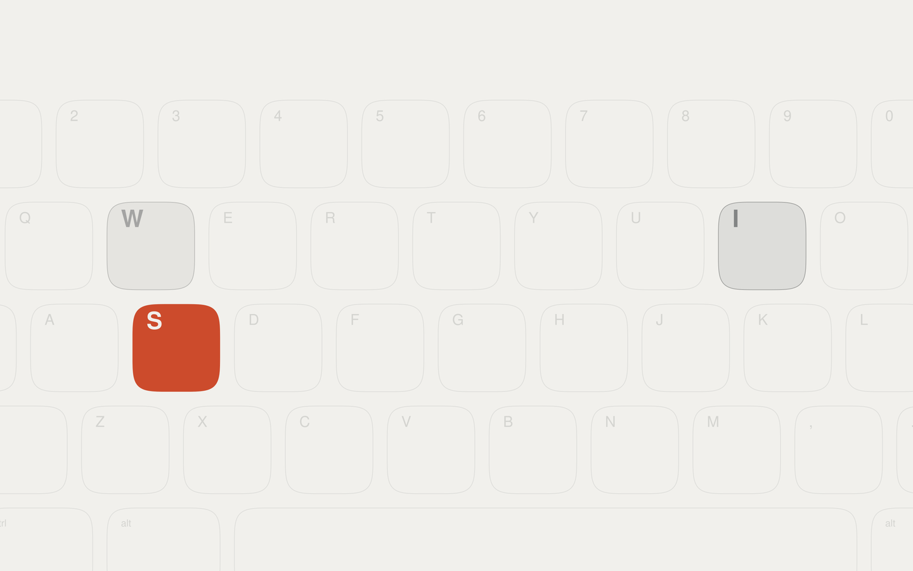

# Swiss Light for Omarchy

Swiss in ink on warm paper, with a deeper orange accent.



## Install

```sh
omarchy-theme-install https://github.com/lagz0ne/omarchy-swiss-light-theme
```

Then pick **Swiss Light** in Style → Theme, or run `omarchy-theme-set "Swiss Light"`.

Wallpapers are oversize squircles, including a keyboard with S‑W‑I‑S‑S typed across it, the latest key in the accent.

## The full look

This theme is one part of [omarchy-swiss](https://github.com/lagz0ne/omarchy-swiss). The bundle adds matching Limine, Plymouth and SDDM screens, a Swiss lock screen and polkit prompt, and a squircle screensaver, all on one type grid. Some touches need the bundle's plugins: `[bar] tile-style` (outline workspace tiles) only takes effect with its workspaces plugin.

Generated from the bundle by `tools/publish-themes.sh`; please send changes there.

MIT. Started from Omarchy's Solitude theme (MIT, © David Heinemeier Hansson).
